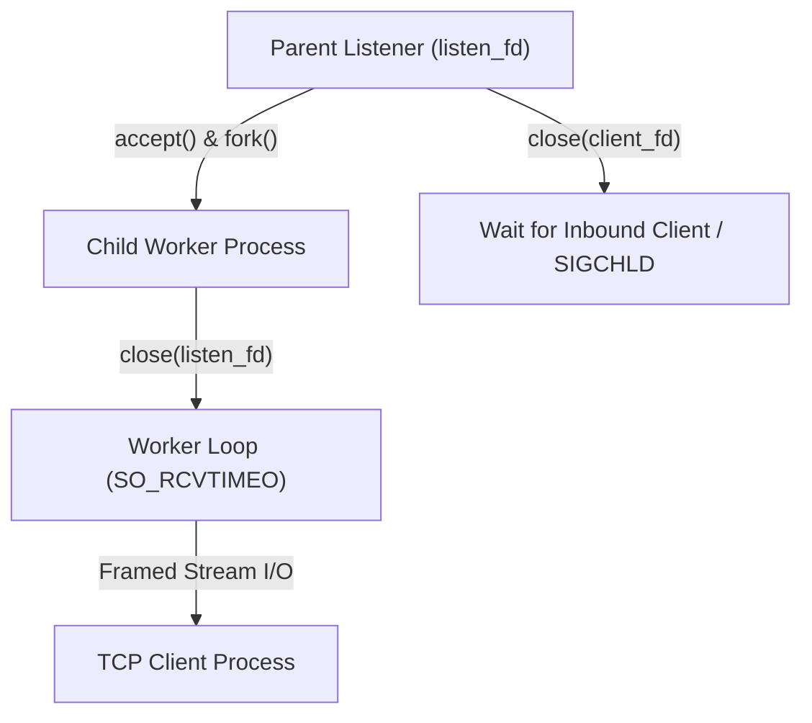
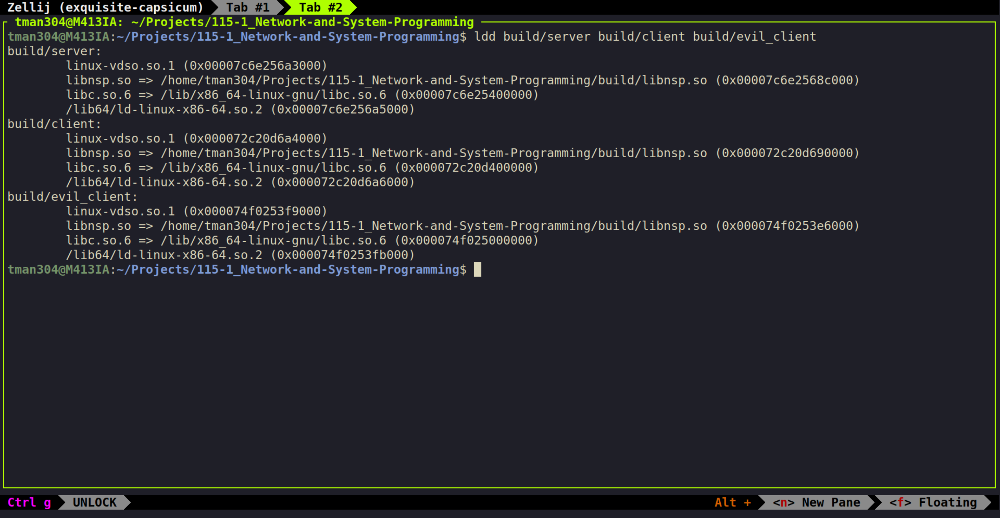
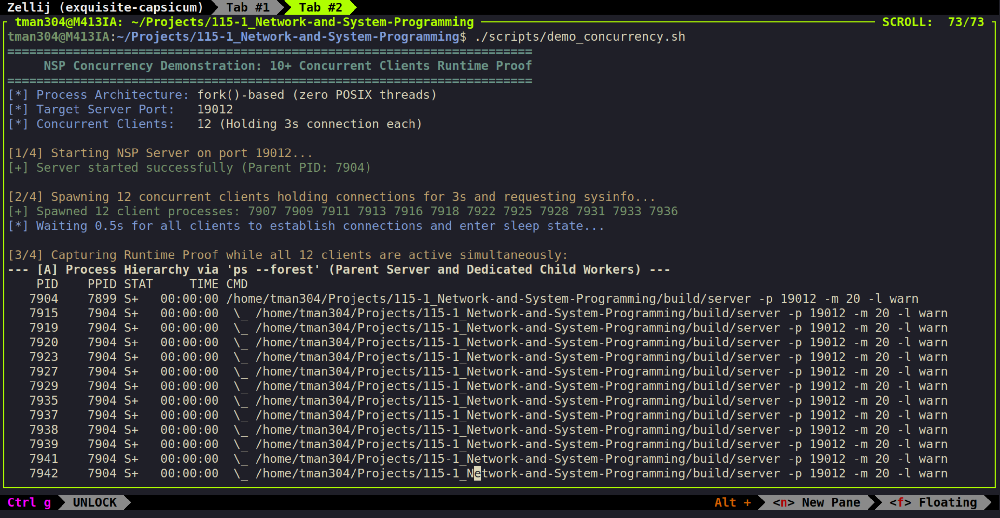
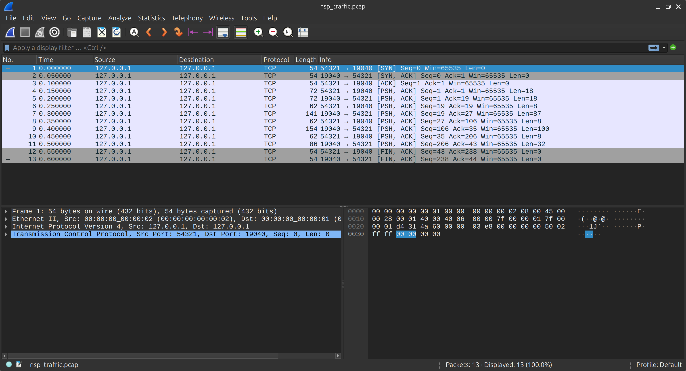
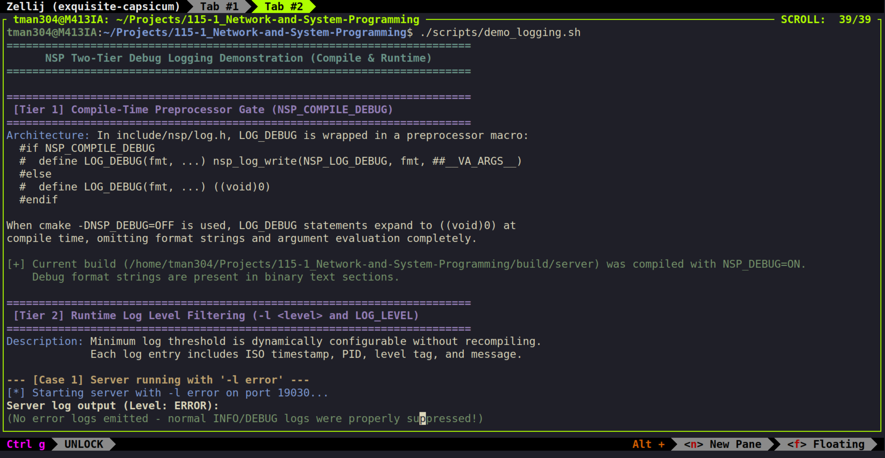
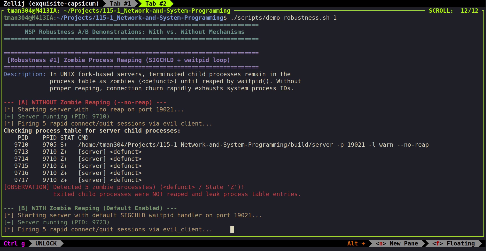
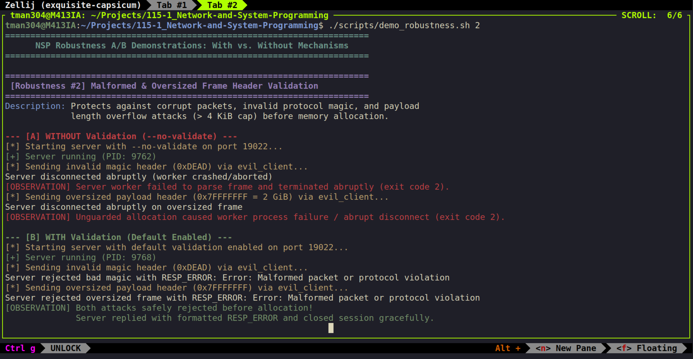
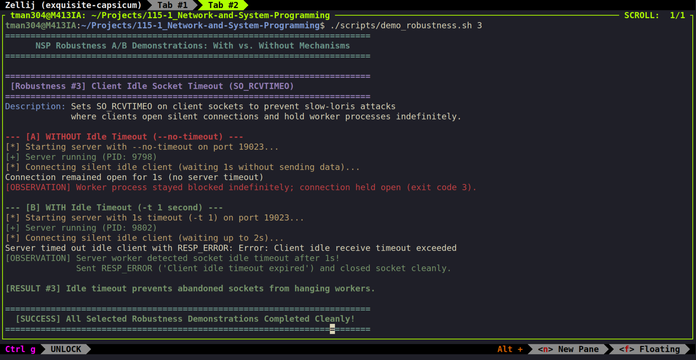
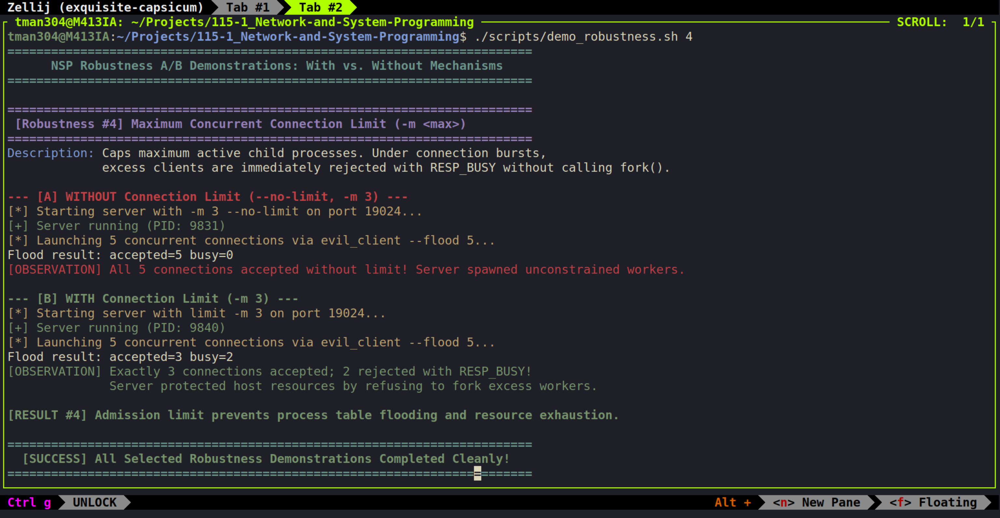
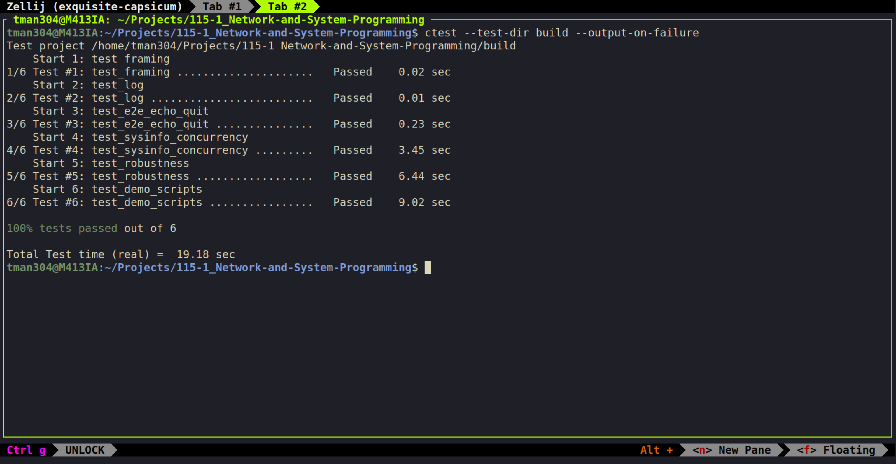

# Midterm Project Report: Remote System Monitor Client-Server Application

**Course:** 115-1 Network and System Programming  
**Project Title:** Fork-Based Remote System Monitor with Shared Dynamic Library and Protocol Robustness  
**Author:** 王界誠  
**Student ID:** 112AB0050  
**Date:** November 2026  
**Environment:** Linux (x86_64), GCC/Clang (C11), CMake 3.16+

---

## Table of Contents

- [Midterm Project Report: Remote System Monitor Client-Server Application](#midterm-project-report-remote-system-monitor-client-server-application)
  - [Table of Contents](#table-of-contents)
  - [1. Introduction](#1-introduction)
  - [2. System Design \& Architecture](#2-system-design--architecture)
    - [2.1 Process-Level Concurrency Model (`fork()`)](#21-process-level-concurrency-model-fork)
    - [2.2 Shared Dynamic Library (`libnsp.so`)](#22-shared-dynamic-library-libnspso)
    - [2.3 Binary Framed Wire Protocol](#23-binary-framed-wire-protocol)
  - [3. Development Process \& Key Implementation Points](#3-development-process--key-implementation-points)
    - [3.1 Reliable Stream I/O \& Protocol Framing](#31-reliable-stream-io--protocol-framing)
    - [3.2 System Monitoring \& 10+ Client Concurrency](#32-system-monitoring--10-client-concurrency)
    - [3.3 Loopback Packet Capture \& Analysis](#33-loopback-packet-capture--analysis)
    - [3.4 Two-Tier Debug Logging Control](#34-two-tier-debug-logging-control)
  - [4. Robustness Mechanisms \& A/B Evaluation](#4-robustness-mechanisms--ab-evaluation)
    - [4.1 Zombie Process Reaping (`SIGCHLD` + `waitpid`)](#41-zombie-process-reaping-sigchld--waitpid)
    - [4.2 Frame Header \& Payload Validation](#42-frame-header--payload-validation)
    - [4.3 Client Idle Socket Timeout (`SO_RCVTIMEO`)](#43-client-idle-socket-timeout-so_rcvtimeo)
    - [4.4 Maximum Concurrent Connection Limit](#44-maximum-concurrent-connection-limit)
  - [5. Automated Testing Mechanism](#5-automated-testing-mechanism)
  - [6. Personal Reflection](#6-personal-reflection)
  - [7. Appendix](#7-appendix)
    - [7.1 Demonstration Video](#71-demonstration-video)
    - [7.2 Build \& Execution Quick Reference](#72-build--execution-quick-reference)
    - [7.3 Source Code Overview](#73-source-code-overview)

---

## 1. Introduction

This report documents the design, implementation, and empirical verification of a multi-client remote system monitoring application developed in C (C11 standard) using CMake for Linux platforms. The system provides real-time telemetry inspection—including operating system release, CPU architecture, load averages, memory distribution, and uptime—over TCP stream sockets.

The server architecture strictly adheres to a process-per-client concurrency model using UNIX `fork()` to guarantee complete address space and fault isolation, prohibiting POSIX threads. Reusable networking, stream I/O, framing, and logging primitives are encapsulated within a dynamic shared library (`libnsp.so`) linked via embedded RPATH (`$ORIGIN`). System reliability is enforced through an 8-byte binary framed protocol, a two-tier logging engine combining zero-overhead compile-time gating with runtime filtering, and four toggleable robustness mechanisms protecting against zombie process accumulation, malformed frames, idle socket hangs, and connection floods.

---

## 2. System Design & Architecture

### 2.1 Process-Level Concurrency Model (`fork()`)

The server employs a multi-process concurrency model using UNIX `fork()` for fault isolation. The parent listener accepts incoming TCP connections and spawns a dedicated child worker process per client. Running in isolated address spaces prevents worker failures from affecting the parent or peer clients.

Following `fork()`, the child closes `listen_fd`, configures socket timeouts, and processes requests in `run_worker_loop()`. The parent immediately closes `client_fd` to prevent descriptor leaks and awaits client termination to perform non-blocking `SIGCHLD` reaping.



### 2.2 Shared Dynamic Library (`libnsp.so`)

Shared protocol serialization (`protocol.c`), stream socket wrappers (`io.c`), and logging routines (`log.c`) are compiled into a shared dynamic library (`libnsp.so`). Binaries (`server`, `client`, `evil_client`) link dynamically against `libnsp.so`. CMake embeds `$ORIGIN` into both `BUILD_RPATH` and `INSTALL_RPATH`, allowing executables to locate the library in their execution directory without adjusting `LD_LIBRARY_PATH`. Dynamic linkage is verified via `ldd`.



### 2.3 Binary Framed Wire Protocol

Communication uses an 8-byte fixed header followed by a variable payload, serialized in big-endian network byte order (`htons`/`htonl`).

| Field | Type | Size | Description |
| :--- | :--- | :--- | :--- |
| `magic` | `uint16_t` | 2 B | Magic constant `0x4E53` (`"NS"`); rejects invalid traffic. |
| `version` | `uint8_t` | 1 B | Protocol version (`0x01`); rejects mismatched versions. |
| `msg_type` | `uint8_t` | 1 B | Request (`0x01`–`0x06`) or response (`0x80`–`0x83`) opcode. |
| `payload_len` | `uint32_t` | 4 B | Big-endian payload byte count (capped at 4096 B). |
| `payload` | `uint8_t[]` | Var | Optional command argument or diagnostic response text. |

---

## 3. Development Process & Key Implementation Points

### 3.1 Reliable Stream I/O & Protocol Framing

Because TCP is an unstructured byte-stream protocol, `send()` and `recv()` calls may transfer fewer bytes than requested due to network fragmentation or kernel buffer constraints. To guarantee complete framing transfers, `libnsp.so` implements `nsp_send_all()` and `nsp_recv_all()`. These functions loop until all requested bytes are transferred, automatically retry on `EINTR` signal interruptions, and suppress `SIGPIPE` using `MSG_NOSIGNAL` to prevent process termination on abruptly severed connections.

```c
ssize_t nsp_send_all(int fd, const void *buf, size_t len) {
    size_t total_sent = 0;
    const uint8_t *ptr = (const uint8_t *)buf;
    while (total_sent < len) {
        ssize_t n = send(fd, ptr + total_sent, len - total_sent, MSG_NOSIGNAL);
        if (n < 0) {
            if (errno == EINTR) continue; /* Retry on signal interrupt */
            return -1;
        }
        if (n == 0) break;
        total_sent += (size_t)n;
    }
    return (ssize_t)total_sent;
}
```

### 3.2 System Monitoring & 10+ Client Concurrency

The monitoring server exposes host telemetry gathered through standard Linux kernel interfaces:

- System overview and OS release via `uname()` and `sysinfo()`.
- System load metrics from `/proc/loadavg` (1, 5, and 15-minute load averages).
- Hardware architecture and memory statistics parsed from `/proc/cpuinfo` and `/proc/meminfo`.
- Server process table statistics enumerated directly from `/proc`.

To empirically validate the multi-client concurrency requirement without threads, the verification script `demo_concurrency.sh` spawns 12 simultaneous client instances holding connections with `sleep 3`. Inspecting the active system via `ps --forest` confirms 12 distinct child worker processes branching from the parent server PID, while `ss -tnp` verifies 12 concurrent socket pairs in `ESTAB` state, each owned by an isolated worker PID.



### 3.3 Loopback Packet Capture & Analysis

Network communications on the loopback interface (`lo`) were captured using `tcpdump` and decoded to verify byte-level wire conformance. Hexadecimal packet inspection confirms that requests and responses strictly align with the 8-byte framing specification:

```text
19:01:18.722154 IP 127.0.0.1.54321 > 127.0.0.1.19040: Flags [P.], length 18
  0x0020:  5018 ffff 0000 0000 4e53 0102 0000 000a  P.......NS......
  0x0030:  4865 6c6c 6f20 4e53 5021                 Hello.NSP!
```

In the capture above:

- Bytes `4e53` confirm the `"NS"` magic constant (`0x4E53`).
- Byte `01` designates protocol version 1.
- Byte `02` specifies the `REQ_ECHO` opcode (or `80` for `RESP_OK` in server replies).
- Bytes `0000 000a` indicate a 10-byte payload, matching the ASCII content `"Hello NSP!"`.



### 3.4 Two-Tier Debug Logging Control

The logging subsystem supports flexible diagnostic tracing without incurring runtime performance penalties in production:

1. **Tier 1 (Compile-Time Gating):** Configured via the CMake option `-DNSP_DEBUG=ON/OFF`. When disabled, the preprocessor evaluates `#if NSP_COMPILE_DEBUG` to 0, expanding `LOG_DEBUG()` macros into `((void)0)`. This completely strips debug string literals and logging overhead from the production binary.
2. **Tier 2 (Runtime Verbosity Filtering):** Controlled via the CLI option `-l debug|info|warn|error` or the `LOG_LEVEL` environment variable. The function `nsp_log_set_level()` dynamically filters console emissions without requiring recompilation.



---

## 4. Robustness Mechanisms & A/B Evaluation

The server defends against four real-world abnormal conditions, evaluated side-by-side using toggle flags (`--no-reap`, `--no-validate`, `--no-timeout`, `--no-limit`) against the adversarial tool `evil_client`:

| Mechanism | Abnormal Condition | Behavior WITHOUT Mechanism | Behavior WITH Mechanism |
| :--- | :--- | :--- | :--- |
| **Zombie Reaping** | Rapid client exit bursts | Dead workers become `<defunct>` zombies | Non-blocking `SIGCHLD` handler reaps workers |
| **Frame Validation** | Malformed magic or length | Worker process aborts or crashes | Validates 8-byte header; sends `RESP_ERROR` |
| **Idle Timeout** | Silent slow-loris connections | Worker hangs indefinitely in `recv()` | `SO_RCVTIMEO` triggers `RESP_ERROR` and exits |
| **Connection Limit** | Connection flood attacks | Unbounded `fork()` exhausts host resources | Drops excess clients with `RESP_BUSY` |

### 4.1 Zombie Process Reaping (`SIGCHLD` + `waitpid`)

Because UNIX signals coalesce when multiple child processes exit concurrently, a non-blocking `waitpid(-1, &status, WNOHANG)` loop inside the `SIGCHLD` handler is necessary to harvest all terminated children while preserving `errno`.

- **Unguarded (`--no-reap`):** Running `evil_client --zombie-burst 5` leaves 5 `<defunct>` zombie processes in the kernel process table.
- **Guarded (Default):** All 5 terminated workers are immediately reaped, maintaining 0 zombies.



### 4.2 Frame Header & Payload Validation

Untrusted network streams may inject invalid magic numbers or corrupt payload lengths:

- **Unguarded (`--no-validate`):** Sending invalid magic (`0xDEAD`) or oversized lengths (`0x7FFFFFFF` = 2 GiB) causes memory allocation failure or abrupt disconnection.
- **Guarded (Default):** The server verifies magic `0x4E53` ("NS") and caps payloads at 4096 bytes before allocation, rejecting malformed frames cleanly with `RESP_ERROR`.



### 4.3 Client Idle Socket Timeout (`SO_RCVTIMEO`)

Silent connections tie up dedicated worker processes indefinitely:

- **Unguarded (`--no-timeout`):** An idle client (`evil_client --idle`) holds the server child worker blocked indefinitely in `recv()`.
- **Guarded (`-t <sec>`):** Sockets configure `SO_RCVTIMEO`. Idle timer expiration yields `EAGAIN`/`EWOULDBLOCK`, triggering `RESP_ERROR` and a clean exit.



### 4.4 Maximum Concurrent Connection Limit

Connection surges risk system exhaustion if `fork()` is called without constraint:

- **Unguarded (`--no-limit`):** Under `evil_client --flood 5`, the server accepts all 5 connections and spawns unconstrained worker processes.
- **Guarded (`-m 3`):** Spawns at most 3 workers; excess connections receive `RESP_BUSY` and close immediately before calling `fork()`.



---

## 5. Automated Testing Mechanism

The test suite is integrated with CMake CTest (`ctest --test-dir build --output-on-failure`), spanning two decoupled testing seams:

1. **Library Unit Seam (`test_framing`, `test_log`):** Employs full-duplex socket pairs (`socketpair(AF_UNIX, SOCK_STREAM, 0, sv)`) to deterministically verify wire framing, endianness conversion, log filtering, and 1-byte fragmented stream reassembly in an isolated bidirectional channel without network latency or external dependencies.
2. **End-to-End Process Seam (`test_e2e_echo_quit`, `test_sysinfo_concurrency`, `test_robustness`, `test_demo_scripts`):** Spawns live `server`, `client`, and `evil_client` binaries across ephemeral TCP loopback ports. These test suites validate the full command lifecycle (`sysinfo`, `echo`, `quit`), prove process isolation across 12 concurrent workers, and automatically assert exit codes and outputs across all four guarded and unguarded robustness modes.



---

## 6. Personal Reflection

- **Process Isolation (`fork()`) vs. Threading:** Providing each connection with an independent address space eliminates shared-memory data races and encapsulates worker crashes without mutexes, trading off higher process spawning latency and serialization overhead.
- **Asynchronous Signal Handling (`SIGCHLD`):** Coalesced signals require non-blocking `waitpid(-1, WNOHANG)` loops and `errno` preservation inside the handler to prevent zombie accumulation without stalling the parent event loop.
- **Stream Framing over TCP:** Because TCP delivers an unstructured byte stream, fixed-size headers with explicit payload lengths and iterative I/O loops handling `EINTR` and partial reads are mandatory for protocol reliability.
- **Defensive Programming & Adversarial Testing:** Developing `evil_client` underscored that resilient servers must explicitly reject invalid headers, cap payload sizes, enforce socket timeouts, and throttle admissions to withstand malformed traffic and resource starvation.

---

## 7. Appendix

### 7.1 Demonstration Video

A 2-minute recorded presentation highlighting dynamic library linkage, 12-client concurrency, packet inspection, and robustness A/B evaluations:

[2-Minute Demonstration Video](./demo_video.mp4)

### 7.2 Build & Execution Quick Reference

```bash
# Debug build & test suite
cmake -B build -DNSP_DEBUG=ON && cmake --build build
ctest --test-dir build --output-on-failure

# Release build (debug logging stripped)
cmake -B build-release -DNSP_DEBUG=OFF -DCMAKE_BUILD_TYPE=Release && cmake --build build-release

# Demonstration scripts
./scripts/demo_concurrency.sh        # 12 concurrent clients proof
./scripts/demo_packet_capture.sh     # Loopback packet inspection
./scripts/demo_robustness.sh all     # Robustness A/B tests
./scripts/demo_logging.sh            # Two-tier logging verification
```

### 7.3 Source Code Overview

| Path | Module | Responsibility |
| :--- | :--- | :--- |
| `include/nsp/*` | Public API | Protocol structures, I/O helpers, and logging macros |
| `src/lib/*` | Shared Library (`libnsp.so`) | Binary serialization, stream transfer with `EINTR` retry, log filtering |
| `src/server/*` | Server Application | Parent listener, worker dispatching, system metric retrieval |
| `src/client/*` | Interactive Client | CLI parser, REPL shell, and formatted responses |
| `src/evil_client/*` | Adversarial Client | Header corruption, idle socket hangs, flood attacks |
| `scripts/*` | Demonstrations | Concurrency proofs, packet captures, robustness A/B tests |
| `tests/*` | CTest Suite | Unit and end-to-end regression test cases |
