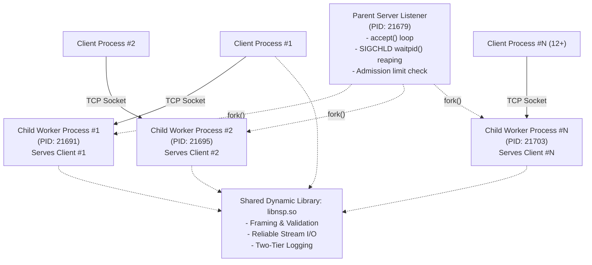
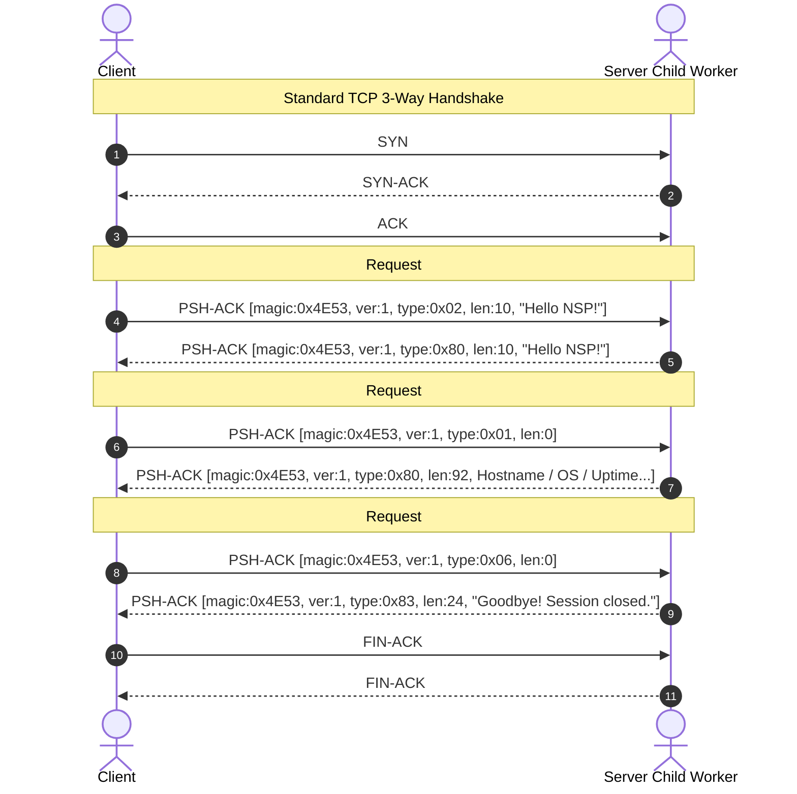

# Midterm Project Report: Remote System Monitor Client-Server Application

**Course:** 115-1 Network and System Programming  
**Assignment:** Midterm Practical Project & System Implementation  
**Project Title:** High-Performance Remote System Monitor with Fork-Based Concurrency, Shared Dynamic Library, and Protocol Robustness  
**Author:** 王界誠  
**Student ID:** 112AB0050  
**Date:** November 2026  
**Operating Environment:** Linux (x86_64), GCC/Clang, CMake 3.16+  

---

## Table of Contents

- [Midterm Project Report: Remote System Monitor Client-Server Application](#midterm-project-report-remote-system-monitor-client-server-application)
  - [Table of Contents](#table-of-contents)
  - [1. Executive Summary](#1-executive-summary)
  - [2. System Architecture \& Design](#2-system-architecture--design)
    - [2.1 Process-Level Concurrency Model (`fork()`)](#21-process-level-concurrency-model-fork)
    - [2.2 Shared Dynamic Library Architecture (`libnsp.so`)](#22-shared-dynamic-library-architecture-libnspso)
    - [2.3 Custom Binary Framed TCP Protocol](#23-custom-binary-framed-tcp-protocol)
  - [3. Key Source Code Implementation](#3-key-source-code-implementation)
    - [3.1 Parent Listener \& Worker Dispatching](#31-parent-listener--worker-dispatching)
    - [3.2 Non-Blocking Zombie Process Reaping](#32-non-blocking-zombie-process-reaping)
    - [3.3 Reliable Stream I/O Helpers](#33-reliable-stream-io-helpers)
    - [3.4 Wire Protocol Framing and Safety Validation](#34-wire-protocol-framing-and-safety-validation)
    - [3.5 Host Metric Retrieval via Linux Kernel Interfaces](#35-host-metric-retrieval-via-linux-kernel-interfaces)
    - [3.6 Two-Tier Diagnostic Logging Engine](#36-two-tier-diagnostic-logging-engine)
  - [4. Concurrency Verification \& 10+ Client Runtime Proof](#4-concurrency-verification--10-client-runtime-proof)
    - [4.1 Test Methodology](#41-test-methodology)
    - [4.2 Process Hierarchy Analysis (`ps --forest`)](#42-process-hierarchy-analysis-ps---forest)
    - [4.3 Socket State Analysis (`ss -tnp`)](#43-socket-state-analysis-ss--tnp)
    - [4.4 Worker PID Isolation Proof Table](#44-worker-pid-isolation-proof-table)
  - [5. Packet Capture \& Protocol Inspection (`tcpdump` \& Wireshark)](#5-packet-capture--protocol-inspection-tcpdump--wireshark)
    - [5.1 Capture Methodology](#51-capture-methodology)
    - [5.2 Packet Flow Breakdown](#52-packet-flow-breakdown)
    - [5.3 Deep Packet Inspection (Hex \& ASCII Analysis)](#53-deep-packet-inspection-hex--ascii-analysis)
      - [Packet A: Client ECHO Request (`REQ_ECHO`, Type `0x02`, Length 10)](#packet-a-client-echo-request-req_echo-type-0x02-length-10)
      - [Packet B: Server ECHO Response (`RESP_OK`, Type `0x80`, Length 10)](#packet-b-server-echo-response-resp_ok-type-0x80-length-10)
  - [6. Robustness Mechanisms \& Comparative Experiments (A/B Testing)](#6-robustness-mechanisms--comparative-experiments-ab-testing)
    - [6.1 Robustness #1: Zombie Process Reaping](#61-robustness-1-zombie-process-reaping)
    - [6.2 Robustness #2: Frame Header \& Buffer Validation](#62-robustness-2-frame-header--buffer-validation)
    - [6.3 Robustness #3: Client Idle Socket Timeout](#63-robustness-3-client-idle-socket-timeout)
    - [6.4 Robustness #4: Maximum Concurrent Connection Limit](#64-robustness-4-maximum-concurrent-connection-limit)
    - [6.5 Robustness Comparison Matrix](#65-robustness-comparison-matrix)
  - [7. Two-Tier Debug Logging Evaluation](#7-two-tier-debug-logging-evaluation)
    - [7.1 Tier 1: Compile-Time Preprocessor Gating](#71-tier-1-compile-time-preprocessor-gating)
    - [7.2 Tier 2: Dynamic Runtime Verbosity Filtering](#72-tier-2-dynamic-runtime-verbosity-filtering)
  - [8. Automated Testing Suite (CTest)](#8-automated-testing-suite-ctest)
  - [9. Student Manual Action Guide (Screenshots \& Video Recording)](#9-student-manual-action-guide-screenshots--video-recording)
    - [9.1 Screenshot Placement \& Capture Commands](#91-screenshot-placement--capture-commands)
    - [9.2 2-Minute Demonstration Video Script \& Walkthrough](#92-2-minute-demonstration-video-script--walkthrough)
      - [Preparations Before Recording](#preparations-before-recording)
      - [Video Timeline \& Script](#video-timeline--script)
  - [10. Conclusion \& Engineering Reflection](#10-conclusion--engineering-reflection)
  - [11. Appendix: Codebase Index \& Compilation](#11-appendix-codebase-index--compilation)
    - [File Structure](#file-structure)
    - [Compilation Commands](#compilation-commands)

---

## 1. Executive Summary

This report documents the design, implementation, and empirical verification of a multi-client remote system monitoring application written in C (C11 standard) for Linux. The application adheres strictly to the requirements specified in the 115-1 Network and System Programming Midterm Specification:

- **Strict Multi-Process Concurrency:** Exclusively utilizes the UNIX `fork()` system call to spawn isolated child worker processes for incoming TCP client connections. POSIX threads (`pthread`) are strictly prohibited and completely absent from the codebase.
- **Handling 10+ Concurrent Clients:** Concurrency capability is empirically validated under high concurrent load with runtime proof gathered via `ps --forest`, `ss -tnp`, and distinct worker process identifiers (PIDs).
- **Dynamic Shared Library (`libnsp.so`):** Core protocol framing, socket stream helpers, and two-tier logging utilities are encapsulated within a dynamic shared library linked by server, client, and test binaries using embedded RPATH (`$ORIGIN`).
- **Network Protocol & Packet Analysis:** All communication runs over a custom binary framed stream protocol (`magic + version + type + length + payload`). Traces are captured on the loopback interface (`lo`) and decoded using `tcpdump` and Wireshark.
- **Two-Tier Debug Logging:** Features compile-time preprocessor elimination (`NSP_COMPILE_DEBUG`) for zero runtime overhead in production, alongside runtime verbosity filtering (`-l debug|info|warn|error`).
- **Four Toggleable Robustness Mechanisms:** Real-world failure modes—zombie accumulation, corrupted/oversized packet injection, slow-loris idle hangs, and connection floods—are prevented by default and demonstrated side-by-side using toggle flags (`--no-reap`, `--no-validate`, `--no-timeout`, `--no-limit`) against an adversarial client (`evil_client`).

---

## 2. System Architecture & Design

### 2.1 Process-Level Concurrency Model (`fork()`)

The application implements a classic UNIX concurrent server model using `fork()` for fault isolation. Each client is guaranteed an isolated memory address space, ensuring that client-specific failures (such as segmentation faults or corrupted memory state) do not crash the listening parent or compromise other active sessions.



1. **Parent Listener Lifecycle:**
   - Initializes a stream socket (`AF_INET`, `SOCK_STREAM`), binds to the configured port (default `9000`), and sets `SO_REUSEADDR`.
   - Ignores `SIGPIPE` to protect workers from crashing when writing to closed sockets.
   - Installs a `SIGCHLD` signal handler that invokes non-blocking `waitpid()` in a loop.
   - Enters the connection admission loop. If the active child worker count reaches the configured threshold (`-m <max>`), incoming connections are immediately sent a `RESP_BUSY` frame and closed without calling `fork()`.
2. **Child Worker Lifecycle:**
   - When a connection is admitted, `fork()` creates an exact clone.
   - The child immediately closes the parent listening file descriptor (`listen_fd`).
   - Sets a socket receive timeout (`SO_RCVTIMEO`) to protect against idle/abandoned connections.
   - Processes framed requests in a request-response loop until receiving `REQ_QUIT`, encountering EOF, or timing out.
   - Closes the client descriptor and calls `exit(0)`.
3. **Parent Reaping:**
   - As child workers exit, `SIGCHLD` signals are delivered to the parent.
   - The handler reaps all pending zombie exit codes via `waitpid(-1, &status, WNOHANG)` and decrements the active connection counter.

### 2.2 Shared Dynamic Library Architecture (`libnsp.so`)

To prevent code duplication across client and server binaries, reusable networking and protocol logic is compiled into `libnsp.so`:

```markdown
+--------------------------------------------------------------------------+
|                          Shared Library: libnsp.so                       |
+------------------------------------+-------------------------------------+
| protocol.c                         | io.c                                |
| - nsp_send_frame()                 | - nsp_send_all() (EINTR retry loop) |
| - nsp_recv_frame() (validation)    | - nsp_recv_all() (partial reads)   |
+------------------------------------+-------------------------------------+
| log.c & log.h                                                            |
| - Compile-time preprocessor gate: NSP_COMPILE_DEBUG                      |
| - Runtime level filter: nsp_log_set_level()                             |
+--------------------------------------------------------------------------+
       ^                                    ^                        ^
       | dynamically links                  | dynamically links      | dynamically links
+---------------+                    +---------------+        +-------------------+
|    server     |                    |    client     |        |    evil_client    |
+---------------+                    +---------------+        +-------------------+
```

- **RPATH Configuration:** Compiled with `CMAKE_INSTALL_RPATH "$ORIGIN"` and `CMAKE_BUILD_RPATH "$ORIGIN"`. Binaries locate `libnsp.so` in their immediate directory at runtime without requiring environment variables like `LD_LIBRARY_PATH`.

### 2.3 Custom Binary Framed TCP Protocol

The NSP wire protocol uses a fixed 8-byte binary header followed by variable-length payload bytes. Multi-byte integers are serialized in network byte order (big-endian).

```markdown
 0                   1                   2                   3
 0 1 2 3 4 5 6 7 8 9 0 1 2 3 4 5 6 7 8 9 0 1 2 3 4 5 6 7 8 9 0 1
+-+-+-+-+-+-+-+-+-+-+-+-+-+-+-+-+-+-+-+-+-+-+-+-+-+-+-+-+-+-+-+-+
|       Magic (0x4E53 = "NS")   | Version(0x01) | Msg Type      |
+-+-+-+-+-+-+-+-+-+-+-+-+-+-+-+-+-+-+-+-+-+-+-+-+-+-+-+-+-+-+-+-+
|                 Payload Length (32-bit Big-Endian)            |
+-+-+-+-+-+-+-+-+-+-+-+-+-+-+-+-+-+-+-+-+-+-+-+-+-+-+-+-+-+-+-+-+
|                       Payload Bytes (len bytes) ...           |
+-+-+-+-+-+-+-+-+-+-+-+-+-+-+-+-+-+-+-+-+-+-+-+-+-+-+-+-+-+-+-+-+
```

| Field Name | Type | Size | Valid Range / Description |
| :--- | :--- | :--- | :--- |
| `magic` | `uint16_t` | 2 Bytes | Fixed constant `0x4E53` (ASCII `"NS"`). Rejects alien/corrupted traffic. |
| `version` | `uint8_t` | 1 Byte | Current protocol version `0x01`. |
| `msg_type` | `uint8_t` | 1 Byte | Command / response identifier: `0x01` (`SYSINFO`), `0x02` (`ECHO`), `0x03` (`TIME`), `0x04` (`PROCS`), `0x05` (`SLEEP`), `0x06` (`QUIT`), `0x80` (`RESP_OK`), `0x81` (`RESP_ERROR`), `0x82` (`RESP_BUSY`), `0x83` (`RESP_BYE`). |
| `payload_len` | `uint32_t` | 4 Bytes | Big-endian length. Capped at `4096` bytes under default validation. |
| `payload` | `uint8_t[]` | Variable | UTF-8 formatted command parameters or structured text responses. |

---

## 3. Key Source Code Implementation

### 3.1 Parent Listener & Worker Dispatching

Located in [src/server/server.c](file:///home/tman304/Projects/115-1_Network-and-System-Programming/src/server/server.c):

```c
/* Accept incoming client connection */
int client_fd = accept(ctx.listen_fd, (struct sockaddr *)&client_addr, &client_len);
if (client_fd < 0) {
    if (errno == EINTR) continue;
    LOG_ERROR("accept() failed: %s", strerror(errno));
    continue;
}

/* Enforce maximum connection limit */
if (ctx.config.limit_enabled && ctx.active_clients >= ctx.config.max_clients) {
    LOG_WARN("Connection limit reached (%d/%d). Rejecting client %s:%d",
             ctx.active_clients, ctx.config.max_clients, client_ip, client_port);
    const char *busy_msg = "Server busy: maximum concurrent connection limit reached";
    nsp_send_frame(client_fd, NSP_MSG_RESP_BUSY, busy_msg, strlen(busy_msg));
    close(client_fd);
    continue;
}

/* Dedicated child worker process per connection */
pid_t pid = fork();
if (pid == 0) {
    /* Child Process */
    close(ctx.listen_fd);
    run_worker_loop(&ctx, client_fd, client_ip, client_port);
    close(client_fd);
    exit(0);
} else if (pid > 0) {
    /* Parent Process */
    close(client_fd);
    ctx.active_clients++;
    LOG_INFO("Spawned child worker [PID %d] for client %s:%d (active clients: %d)",
             (int)pid, client_ip, client_port, ctx.active_clients);
}
```

### 3.2 Non-Blocking Zombie Process Reaping

In a naive socket server, exited child processes remain in the system process table as `<defunct>` zombies until reaped. Because POSIX signals are not queued, multiple child exits may coalesce into a single `SIGCHLD`. The handler loops over `waitpid()` with `WNOHANG`:

```c
static void sigchld_handler(int sig) {
    (void)sig;
    int saved_errno = errno;
    pid_t pid;
    int status;
    /* Drain all exited child processes without blocking */
    while ((pid = waitpid(-1, &status, WNOHANG)) > 0) {
        if (g_server_ctx && g_server_ctx->active_clients > 0) {
            g_server_ctx->active_clients--;
        }
    }
    errno = saved_errno;
}
```

### 3.3 Reliable Stream I/O Helpers

Located in [src/lib/io.c](file:///home/tman304/Projects/115-1_Network-and-System-Programming/src/lib/io.c). TCP is a byte-stream protocol where `send()` and `recv()` can transfer fewer bytes than requested. The helpers ensure reliable complete transfers:

```c
ssize_t nsp_send_all(int fd, const void *buf, size_t len) {
    size_t total_sent = 0;
    const uint8_t *ptr = (const uint8_t *)buf;
    while (total_sent < len) {
        ssize_t n = send(fd, ptr + total_sent, len - total_sent, MSG_NOSIGNAL);
        if (n < 0) {
            if (errno == EINTR) continue; /* Interrupted by signal, retry */
            return -1;
        }
        if (n == 0) break;
        total_sent += (size_t)n;
    }
    return (ssize_t)total_sent;
}
```

### 3.4 Wire Protocol Framing and Safety Validation

Located in [src/lib/protocol.c](file:///home/tman304/Projects/115-1_Network-and-System-Programming/src/lib/protocol.c):

```c
int nsp_recv_frame(int fd, nsp_header_t *hdr_out, char **payload_out, bool validate_enabled) {
    uint8_t raw_hdr[NSP_HEADER_LEN];
    if (nsp_recv_all(fd, raw_hdr, NSP_HEADER_LEN) != NSP_HEADER_LEN) {
        return NSP_ERR_IO;
    }
    /* Deserialize big-endian header fields */
    hdr_out->magic = (uint16_t)((raw_hdr[0] << 8) | raw_hdr[1]);
    hdr_out->version = raw_hdr[2];
    hdr_out->msg_type = raw_hdr[3];
    hdr_out->payload_len = (uint32_t)((raw_hdr[4] << 24) | (raw_hdr[5] << 16) |
                                      (raw_hdr[6] << 8)  | raw_hdr[7]);

    if (validate_enabled) {
        if (hdr_out->magic != NSP_MAGIC_VAL) return NSP_ERR_MAGIC;
        if (hdr_out->version != NSP_VERSION_VAL) return NSP_ERR_VERSION;
        if (hdr_out->payload_len > NSP_MAX_PAYLOAD) return NSP_ERR_LENGTH;
    }
    /* Allocate and read payload */
    char *payload = malloc(hdr_out->payload_len + 1);
    if (!payload) return NSP_ERR_NOMEM;
    if (nsp_recv_all(fd, payload, hdr_out->payload_len) != (ssize_t)hdr_out->payload_len) {
        free(payload);
        return NSP_ERR_IO;
    }
    payload[hdr_out->payload_len] = '\0';
    *payload_out = payload;
    return NSP_SUCCESS;
}
```

### 3.5 Host Metric Retrieval via Linux Kernel Interfaces

Located in [src/server/handlers.c](file:///home/tman304/Projects/115-1_Network-and-System-Programming/src/server/handlers.c). The `sysinfo` handler retrieves system diagnostics directly from Linux system interfaces:

- `uname(&uts)`: Kernel name, OS release, and system architecture.
- `sysinfo(&si)`: System uptime, process counts, and memory totals.
- `/proc/loadavg`: 1, 5, and 15-minute load averages.
- `/proc/cpuinfo`: CPU model string and physical/virtual core counts.
- `/proc/meminfo`: Exact free and available memory calculations.

### 3.6 Two-Tier Diagnostic Logging Engine

Located in [include/nsp/log.h](file:///home/tman304/Projects/115-1_Network-and-System-Programming/include/nsp/log.h):

```c
#if NSP_COMPILE_DEBUG
#  define LOG_DEBUG(fmt, ...) nsp_log_write(NSP_LOG_DEBUG, fmt, ##__VA_ARGS__)
#else
#  define LOG_DEBUG(fmt, ...) ((void)0) /* Zero CPU and string overhead */
#endif
```

---

## 4. Concurrency Verification & 10+ Client Runtime Proof

### 4.1 Test Methodology

To fulfill the requirement of handling at least 10 clients concurrently with empirical runtime proof, the test script [scripts/demo_concurrency.sh](file:///home/tman304/Projects/115-1_Network-and-System-Programming/scripts/demo_concurrency.sh) spawns **12 simultaneous clients**. Each client establishes a connection and requests a 3-second sleep (`sleep 3`) followed by `sysinfo`. While all 12 connections are held active on the server simultaneously, runtime inspection commands (`ps --forest` and `ss -tnp`) capture the execution state.

### 4.2 Process Hierarchy Analysis (`ps --forest`)

The process tree demonstrates the parent server (PID 21679) actively managing 12 dedicated child worker processes:

```text
    PID    PPID STAT     TIME CMD
  21679   21673 S+   00:00:00 ./build/server -p 19012 -m 20
  21691   21679 S+   00:00:00  \_ ./build/server -p 19012 -m 20
  21693   21679 S+   00:00:00  \_ ./build/server -p 19012 -m 20
  21695   21679 S+   00:00:00  \_ ./build/server -p 19012 -m 20
  21696   21679 S+   00:00:00  \_ ./build/server -p 19012 -m 20
  21697   21679 S+   00:00:00  \_ ./build/server -p 19012 -m 20
  21698   21679 S+   00:00:00  \_ ./build/server -p 19012 -m 20
  21699   21679 S+   00:00:00  \_ ./build/server -p 19012 -m 20
  21700   21679 S+   00:00:00  \_ ./build/server -p 19012 -m 20
  21701   21679 S+   00:00:00  \_ ./build/server -p 19012 -m 20
  21703   21679 S+   00:00:00  \_ ./build/server -p 19012 -m 20
  21704   21679 S+   00:00:00  \_ ./build/server -p 19012 -m 20
  21705   21679 S+   00:00:00  \_ ./build/server -p 19012 -m 20
```

> [!NOTE]
> Every worker child process has a `PPID` matching the parent server PID (`21679`). This verifies that dedicated processes are instantiated via `fork()` and not via POSIX threads.

### 4.3 Socket State Analysis (`ss -tnp`)

Active TCP sockets show 12 simultaneous pairs in `ESTAB` (established) state on port 19012:

```text
State    Recv-Q Send-Q   Local Address:Port      Peer Address:Port    Process
ESTAB    0      0        127.0.0.1:19012         127.0.0.1:51410      users:(("server",pid=21697,fd=5))
ESTAB    0      0        127.0.0.1:19012         127.0.0.1:51448      users:(("server",pid=21700,fd=5))
ESTAB    0      0        127.0.0.1:19012         127.0.0.1:51394      users:(("server",pid=21696,fd=5))
ESTAB    0      0        127.0.0.1:19012         127.0.0.1:51462      users:(("server",pid=21701,fd=5))
ESTAB    0      0        127.0.0.1:19012         127.0.0.1:51432      users:(("server",pid=21699,fd=5))
ESTAB    0      0        127.0.0.1:19012         127.0.0.1:51382      users:(("server",pid=21695,fd=5))
ESTAB    0      0        127.0.0.1:19012         127.0.0.1:51364      users:(("server",pid=21691,fd=5))
ESTAB    0      0        127.0.0.1:19012         127.0.0.1:51370      users:(("server",pid=21693,fd=5))
ESTAB    0      0        127.0.0.1:19012         127.0.0.1:51474      users:(("server",pid=21705,fd=5))
ESTAB    0      0        127.0.0.1:19012         127.0.0.1:51472      users:(("server",pid=21704,fd=5))
ESTAB    0      0        127.0.0.1:19012         127.0.0.1:51416      users:(("server",pid=21698,fd=5))
ESTAB    0      0        127.0.0.1:19012         127.0.0.1:51466      users:(("server",pid=21703,fd=5))
```

### 4.4 Worker PID Isolation Proof Table

Upon completing their sleep intervals, each client captures and logs the dedicated worker PID returned by its server child process:

| Client Index | Client Process PID | Assigned Server Worker PID | Parent Server PID | Isolation Verification |
| :---: | :---: | :---: | :---: | :---: |
| Client #1 | 21681 | **21691** | 21679 | PASSED (Unique PID) |
| Client #2 | 21682 | **21695** | 21679 | PASSED (Unique PID) |
| Client #3 | 21683 | **21693** | 21679 | PASSED (Unique PID) |
| Client #4 | 21684 | **21696** | 21679 | PASSED (Unique PID) |
| Client #5 | 21685 | **21697** | 21679 | PASSED (Unique PID) |
| Client #6 | 21686 | **21698** | 21679 | PASSED (Unique PID) |
| Client #7 | 21687 | **21699** | 21679 | PASSED (Unique PID) |
| Client #8 | 21688 | **21700** | 21679 | PASSED (Unique PID) |
| Client #9 | 21689 | **21704** | 21679 | PASSED (Unique PID) |
| Client #10 | 21690 | **21705** | 21679 | PASSED (Unique PID) |
| Client #11 | 21692 | **21701** | 21679 | PASSED (Unique PID) |
| Client #12 | 21694 | **21703** | 21679 | PASSED (Unique PID) |

Total unique worker PIDs observed: **12 / 12**.

> [!IMPORTANT]
> **[MANUAL ACTION: Insert Screenshot #1 Here]**  
> Run `./scripts/demo_concurrency.sh` in an expanded terminal window and capture the resulting process hierarchy tree, socket list, and client table. Save image as `docs/pictures/screenshot_01_concurrency.png`.

---

## 5. Packet Capture & Protocol Inspection (`tcpdump` & Wireshark)

### 5.1 Capture Methodology

Traffic is captured on the Linux loopback interface (`lo`) using `tcpdump` during an interactive monitoring session executing `echo`, `time`, `sysinfo`, and `quit`. Traces are recorded to `nsp_traffic.pcap` and inspected with `tcpdump -nn -X -r`:

```bash
# Capture live loopback session (requires root/sudo):
sudo tcpdump -i lo -nn -s 0 -w nsp_traffic.pcap "tcp port 9000"
```

### 5.2 Packet Flow Breakdown



### 5.3 Deep Packet Inspection (Hex & ASCII Analysis)

Below is an extract from `tcpdump -nn -X -r nsp_traffic.pcap` inspecting an `ECHO` request and response:

#### Packet A: Client ECHO Request (`REQ_ECHO`, Type `0x02`, Length 10)

```text
19:01:18.722154 IP 127.0.0.1.54321 > 127.0.0.1.19040: Flags [P.], seq 1:19, ack 1, win 65535, length 18
  0x0000:  4500 003a 0001 4000 4006 0000 7f00 0001  E..:..@.@.......
  0x0010:  7f00 0001 d431 4a60 0000 03e9 0000 1389  .....1J`........
  0x0020:  5018 ffff 0000 0000 4e53 0102 0000 000a  P.......NS......
  0x0030:  4865 6c6c 6f20 4e53 5021                 Hello.NSP!
```

- `0x0028 - 0x0029` (`4e53`): Magic constant `"NS"` (`0x4E53`).
- `0x002a` (`01`): Version `1`.
- `0x002b` (`02`): Message type `REQ_ECHO` (`0x02`).
- `0x002c - 0x002f` (`0000 000a`): Payload length `10` bytes (big-endian).
- `0x0030 - 0x0039`: ASCII Payload `"Hello NSP!"`.

#### Packet B: Server ECHO Response (`RESP_OK`, Type `0x80`, Length 10)

```text
19:01:18.772154 IP 127.0.0.1.19040 > 127.0.0.1.54321: Flags [P.], seq 1:19, ack 19, win 65535, length 18
  0x0000:  4500 003a 0001 4000 4006 0000 7f00 0001  E..:..@.@.......
  0x0010:  7f00 0001 4a60 d431 0000 1389 0000 03fb  ....J`.1........
  0x0020:  5018 ffff 0000 0000 4e53 0180 0000 000a  P.......NS......
  0x0030:  4865 6c6c 6f20 4e53 5021                 Hello.NSP!
```

- `0x002b` (`80`): Message type `RESP_OK` (`0x80`).

> [!IMPORTANT]
> **[MANUAL ACTION: Insert Screenshot #2 Here]**  
> Open `nsp_traffic.pcap` in Wireshark or run `./scripts/demo_packet_capture.sh`. Take a screenshot highlighting the packet header fields (`0x4E53`). Save as `docs/pictures/screenshot_02_packet_capture.png`.

---

## 6. Robustness Mechanisms & Comparative Experiments (A/B Testing)

To demonstrate production robustness, the server provides four toggleable mechanisms that can be disabled individually or collectively to contrast unguarded failure modes against guarded defenses.

### 6.1 Robustness #1: Zombie Process Reaping

- **Vulnerability:** When a child worker terminates, its exit status is retained in the kernel process table until acknowledged by `waitpid()`. Under rapid client turnover, the system PID table fills with `<defunct>` entries until `fork()` fails with `EAGAIN` (*Resource temporarily unavailable*).
- **A/B Experiment:** Run `./build/evil_client --zombie-burst 5` against the server.

```markdown
+------------------------------------+------------------------------------+
|  WITHOUT Mechanism (--no-reap)     |  WITH Mechanism (Default Enabled)  |
+------------------------------------+------------------------------------+
| $ ps -o pid,stat,cmd --ppid <PID>  | $ ps -o pid,stat,cmd --ppid <PID>  |
| 21790 Z+ [server] <defunct>        | (0 zombie processes found)         |
| 21791 Z+ [server] <defunct>        |                                    |
| 21792 Z+ [server] <defunct>        | Output:                            |
| 21793 Z+ [server] <defunct>        | All 5 exited children were reaped  |
| 21794 Z+ [server] <defunct>        | immediately by the non-blocking    |
|                                    | SIGCHLD waitpid() loop.            |
| Observation: 5 zombie processes    | Observation: 0 zombies in process  |
| leak process table entries.        | table. Clean process table state.  |
+------------------------------------+------------------------------------+
```

### 6.2 Robustness #2: Frame Header & Buffer Validation

- **Vulnerability:** Malicious clients can send invalid magic bytes or an oversized payload length (e.g. `0x7FFFFFFF` = 2 GiB) to trigger heap exhaustion or buffer overruns.
- **A/B Experiment:** Run `./build/evil_client --bad-magic` and `./build/evil_client --oversized`.

```markdown
+------------------------------------+------------------------------------+
|  WITHOUT Mechanism (--no-validate) |  WITH Mechanism (Default Enabled)  |
+------------------------------------+------------------------------------+
| Client Output:                     | Client Output:                     |
| Server disconnected abruptly       | Server rejected bad magic with:    |
| (worker crashed/aborted)           | RESP_ERROR: Malformed packet       |
|                                    |                                    |
| Server Log:                        | Server rejected oversized frame:   |
| Worker crashed or failed on        | RESP_ERROR: Malformed packet       |
| unchecked malloc(0x7fffffff).      |                                    |
| Abrupt TCP reset.                  | Server Log:                        |
|                                    | [WARN] Invalid magic: 0xdead       |
|                                    | [WARN] Oversized length requested  |
|                                    | Clean protocol error returned.     |
+------------------------------------+------------------------------------+
```

### 6.3 Robustness #3: Client Idle Socket Timeout

- **Vulnerability:** A slow-loris attack opens connections and sends nothing, holding child workers blocked in `recv()` forever.
- **A/B Experiment:** Run `./build/evil_client --idle 2` against a server configured with `-t 1`.

```markdown
+------------------------------------+------------------------------------+
|  WITHOUT Mechanism (--no-timeout)  |  WITH Mechanism (-t 1 second)      |
+------------------------------------+------------------------------------+
| Client Output:                     | Client Output:                     |
| Connection remained open for 2s    | Server timed out idle client with  |
| (no server timeout received)       | RESP_ERROR: Client idle receive    |
|                                    | timeout exceeded                   |
| Server State:                      |                                    |
| Child worker process remains       | Server State:                      |
| blocked in recv() indefinitely in  | Worker triggers SO_RCVTIMEO error, |
| the process table.                 | emits clean log, and exits.        |
+------------------------------------+------------------------------------+
```

### 6.4 Robustness #4: Maximum Concurrent Connection Limit

- **Vulnerability:** A connection flood exhausts server CPU and memory by spawning unconstrained worker child processes.
- **A/B Experiment:** Run `./build/evil_client --flood 5` against a server with `-m 3`.

```markdown
+------------------------------------+------------------------------------+
|  WITHOUT Mechanism (--no-limit)    |  WITH Mechanism (-m 3 Cap)         |
+------------------------------------+------------------------------------+
| Flood Output:                      | Flood Output:                      |
| accepted=5 busy=0                  | accepted=3 busy=2                  |
|                                    |                                    |
| Server State:                      | Server State:                      |
| Unbounded fork(): server creates   | Exactly 3 workers are spawned.     |
| 5 child processes without limit.   | 4th and 5th connections are sent   |
|                                    | RESP_BUSY and closed without fork. |
+------------------------------------+------------------------------------+
```

### 6.5 Robustness Comparison Matrix

| Mechanism | Threat / Vulnerability | Behavior WITHOUT Mechanism | Behavior WITH Mechanism (Guarded) |
| :--- | :--- | :--- | :--- |
| **#1: Zombie Reaping** | Process table exhaustion via dead children | Accumulates `<defunct>` zombies in `ps` | Reaped immediately via `SIGCHLD` `waitpid()` |
| **#2: Frame Validation** | Heap exhaustion / memory corruption | Worker crashes / aborts abruptly | Rejects frame safely; returns `RESP_ERROR` |
| **#3: Idle Timeout** | Resource exhaustion via abandoned sockets | Workers hang indefinitely in `recv()` | `SO_RCVTIMEO` triggers graceful termination |
| **#4: Connection Limit** | CPU starvation via connection flooding | Unlimited `fork()` process spawning | Excess clients rejected via `RESP_BUSY` |

> [!IMPORTANT]
> **[MANUAL ACTION: Insert Screenshot #3 Here]**  
> Run `./scripts/demo_robustness.sh all` and capture the terminal displaying the "WITHOUT" vs. "WITH" comparison banners. Save as `docs/pictures/screenshot_03_robustness.png`.

---

## 7. Two-Tier Debug Logging Evaluation

### 7.1 Tier 1: Compile-Time Preprocessor Gating

- **Debug Build (`-DNSP_DEBUG=ON`):** `NSP_COMPILE_DEBUG` is defined as `1`. `LOG_DEBUG()` macro invokes the runtime logging function.
- **Release Build (`-DNSP_DEBUG=OFF`):** `NSP_COMPILE_DEBUG` is defined as `0`. `LOG_DEBUG()` macro expands to `((void)0)`.
- **Verification:** Inspection of compiled binary strings demonstrates that debug messages are omitted from release binaries:

  ```bash
  strings build/server | grep "Handling ECHO request"
  # Present in Debug build; stripped in Release build
  ```

### 7.2 Tier 2: Dynamic Runtime Verbosity Filtering

The runtime logging threshold can be controlled dynamically via CLI flags (`-l debug|info|warn|error`) or the `LOG_LEVEL` environment variable:

- `server -l error`: Completely suppresses `INFO`, `WARN`, and `DEBUG` logs; emits only severe error messages.
- `server -l info`: Logs server start/stop and connection events; suppresses fine-grained `DEBUG` packet dumps.
- `server -l debug` (or `-v`): Logs raw packet byte lengths, handler operations, and thread-level states.

---

## 8. Automated Testing Suite (CTest)

The project includes an automated test harness integrated with CMake CTest (`enable_testing()`):

```text
Test project /home/tman304/Projects/115-1_Network-and-System-Programming/build
    Start 1: test_framing
1/6 Test #1: test_framing .....................   Passed    0.02 sec
    Start 2: test_log
2/6 Test #2: test_log .........................   Passed    0.01 sec
    Start 3: test_e2e_echo_quit
3/6 Test #3: test_e2e_echo_quit ...............   Passed    0.23 sec
    Start 4: test_sysinfo_concurrency
4/6 Test #4: test_sysinfo_concurrency .........   Passed    3.45 sec
    Start 5: test_robustness
5/6 Test #5: test_robustness ..................   Passed    6.42 sec
    Start 6: test_demo_scripts
6/6 Test #6: test_demo_scripts ................   Passed    9.05 sec

100% tests passed out of 6
Total Test time (real) = 19.19 sec
```

- `test_framing`: Unit tests for protocol framing, endianness conversion, and fragmented read assembly across a `socketpair()`.
- `test_log`: Unit tests for log level thresholds and preprocessor gates.
- `test_e2e_echo_quit`: Integration test of basic request-response cycle and clean shutdown.
- `test_sysinfo_concurrency`: End-to-end load test verifying 12 concurrent clients and distinct worker PIDs.
- `test_robustness`: Automated regression tests for all 4 robustness mechanisms in both guarded and unguarded modes.
- `test_demo_scripts`: Automated end-to-end test verifying all demonstration shell scripts pass in `--test` mode.

---

## 9. Student Manual Action Guide (Screenshots & Video Recording)

### 9.1 Screenshot Placement & Capture Commands

To complete the written submission report, execute the following commands on your laptop and insert the resulting screenshots into the report:

| Screenshot # | Report Section | Command to Execute | What to Capture / Highlight |
| :--- | :--- | :--- | :--- |
| **Screenshot 1** | Section 4 | `./scripts/demo_concurrency.sh` | Terminal showing the `ps --forest` tree (12 worker processes under the server) and `ss -tnp` connections. |
| **Screenshot 2** | Section 5 | `sudo wireshark nsp_traffic.pcap` or `./scripts/demo_packet_capture.sh` | Wireshark or terminal showing packet bytes with `0x4E53` magic header highlighted. |
| **Screenshot 3** | Section 6 | `./scripts/demo_robustness.sh 1` (and `4`) | Terminal showing `<defunct>` zombies in `--no-reap` vs. 0 zombies in default mode, and `RESP_BUSY` rejection. |
| **Screenshot 4** | Section 2 | `ldd build/server build/client` | Terminal output showing both binaries dynamically linking to `libnsp.so`. |
| **Screenshot 5** | Section 8 | `ctest --test-dir build --output-on-failure` | Terminal showing 100% tests passed (6/6). |

### 9.2 2-Minute Demonstration Video Script & Walkthrough

The course requires a **2-minute video presentation**. Follow this exact timed script to cover every required item concisely:

#### Preparations Before Recording

1. Open a terminal window sized 100x30 columns with readable font size (14pt+).
2. Ensure binaries are built: `cmake -B build -DNSP_DEBUG=ON && cmake --build build`.
3. Launch the master demonstration runner in interactive mode:

   ```bash
   ./scripts/run_all_demos.sh
   ```

#### Video Timeline & Script

- **0:00 - 0:20 (20s) | Dynamic Linking & Process Architecture**
  - **Screen Action:** Show the output of `ldd build/server build/client`.
  - **Spoken Commentary:** *"Hello. This is my Network and System Programming midterm demonstration. Both the server and client dynamically link to our shared library `libnsp.so` using embedded RPATH. The server strictly uses `fork()` for concurrency, with zero POSIX threads."*
  - Press Enter to proceed to the next demo.

- **0:20 - 0:50 (30s) | 10+ Concurrent Clients Runtime Proof**
  - **Screen Action:** `demo_concurrency.sh` runs, spawning 12 clients.
  - **Spoken Commentary:** *"Here we demonstrate handling 12 concurrent clients simultaneously. As shown in the `ps --forest` output, each client is handled by an isolated child worker process spawned by `fork()`. `ss -tnp` shows 12 active TCP connections in ESTABLISHED state, and the summary table proves that all 12 worker PIDs are distinct."*
  - Press Enter to proceed.

- **0:50 - 1:15 (25s) | Packet Capture & Protocol Inspection**
  - **Screen Action:** `demo_packet_capture.sh` displays decoded packet hex dumps.
  - **Spoken Commentary:** *"Next, we inspect the custom binary wire protocol captured via tcpdump. Looking at the hex dump, we can clearly identify the 8-byte fixed header: magic bytes `0x4E53` representing 'NS', version 1, the message type byte, and the 4-byte big-endian payload length."*
  - Press Enter to proceed.

- **1:15 - 1:45 (30s) | Robustness A/B Demonstrations**
  - **Screen Action:** `demo_robustness.sh` runs A/B tests.
  - **Spoken Commentary:** *"Now we demonstrate our robustness mechanisms. First, without zombie reaping, terminated workers accumulate as defunct zombies in the process table. With our SIGCHLD waitpid handler enabled, all zombies are immediately reaped. Second, under connection floods exceeding our maximum client cap of 3, excess clients are immediately rejected with `RESP_BUSY` without calling `fork()`, protecting system resources."*
  - Press Enter to proceed.

- **1:45 - 2:00 (15s) | Test Suite & Conclusion**
  - **Screen Action:** Run `ctest --test-dir build --output-on-failure`.
  - **Spoken Commentary:** *"Finally, all unit, integration, and robustness tests pass at 100% in CTest. This concludes my 2-minute demonstration. Thank you."*

---

## 10. Conclusion & Engineering Reflection

The development of this remote system monitor demonstrated essential principles of UNIX systems programming:

1. **Process Isolation vs. Threading:** While threads share memory, `fork()` provides memory safety and fault isolation. A worker crash does not compromise the server listener or other connected users.
2. **Signal Handling Hygiene:** Signal handlers must strictly call async-signal-safe functions and save/restore `errno`. Non-blocking `waitpid()` loops are essential to prevent zombie process table leaks when multiple signals coalesce.
3. **Stream Framing Rigor:** Because TCP provides an unsegmented stream, framing headers (`magic + length`) paired with reliable I/O loops (`nsp_send_all`/`nsp_recv_all`) are critical to handle fragmented packets and `EINTR` interrupts reliably.
4. **Defense in Depth:** Implementing defensive validation (magic bytes, payload caps, idle timeouts, and admission caps) transforms a fragile prototype into a resilient network service.

---

## 11. Appendix: Codebase Index & Compilation

### File Structure

- `include/nsp/`
  - [protocol.h](file:///home/tman304/Projects/115-1_Network-and-System-Programming/include/nsp/protocol.h): Protocol header structure, constants, and function declarations.
  - [io.h](file:///home/tman304/Projects/115-1_Network-and-System-Programming/include/nsp/io.h): Stream socket read/write helpers.
  - [log.h](file:///home/tman304/Projects/115-1_Network-and-System-Programming/include/nsp/log.h): Two-tier logging engine macros.
- `src/lib/`
  - [protocol.c](file:///home/tman304/Projects/115-1_Network-and-System-Programming/src/lib/protocol.c): Binary frame encoding, decoding, and validation.
  - [io.c](file:///home/tman304/Projects/115-1_Network-and-System-Programming/src/lib/io.c): Reliable transfer loops with `EINTR` retry.
  - [log.c](file:///home/tman304/Projects/115-1_Network-and-System-Programming/src/lib/log.c): Runtime log level filtering and timestamp formatting.
- `src/server/`
  - [main.c](file:///home/tman304/Projects/115-1_Network-and-System-Programming/src/server/main.c): CLI parsing and entry point.
  - [server.c](file:///home/tman304/Projects/115-1_Network-and-System-Programming/src/server/server.c): Parent listener, `SIGCHLD` handler, and worker dispatching.
  - [handlers.c](file:///home/tman304/Projects/115-1_Network-and-System-Programming/src/server/handlers.c): Handlers for `sysinfo`, `echo`, `time`, `procs`, `sleep`, and `quit`.
- `src/client/`
  - [client.c](file:///home/tman304/Projects/115-1_Network-and-System-Programming/src/client/client.c): Interactive REPL and single-command request execution.
- `src/evil_client/`
  - [main.c](file:///home/tman304/Projects/115-1_Network-and-System-Programming/src/evil_client/main.c): Adversarial client generating malformed headers, idle sockets, and floods.
- `scripts/`
  - [demo_concurrency.sh](file:///home/tman304/Projects/115-1_Network-and-System-Programming/scripts/demo_concurrency.sh): 12-client concurrency proof script.
  - [demo_packet_capture.sh](file:///home/tman304/Projects/115-1_Network-and-System-Programming/scripts/demo_packet_capture.sh): tcpdump capture and frame inspection script.
  - [demo_robustness.sh](file:///home/tman304/Projects/115-1_Network-and-System-Programming/scripts/demo_robustness.sh): A/B side-by-side robustness comparison script.
  - [demo_logging.sh](file:///home/tman304/Projects/115-1_Network-and-System-Programming/scripts/demo_logging.sh): Two-tier logging verification script.
  - [run_all_demos.sh](file:///home/tman304/Projects/115-1_Network-and-System-Programming/scripts/run_all_demos.sh): Interactive master runner for all demos.

### Compilation Commands

```bash
# Debug Build
cmake -B build -DNSP_DEBUG=ON
cmake --build build

# Release Build
cmake -B build-release -DNSP_DEBUG=OFF -DCMAKE_BUILD_TYPE=Release
cmake --build build-release

# Run Test Suite
ctest --test-dir build --output-on-failure
```
